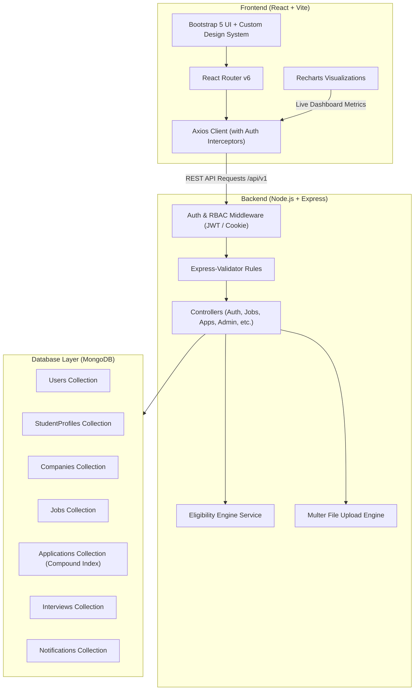
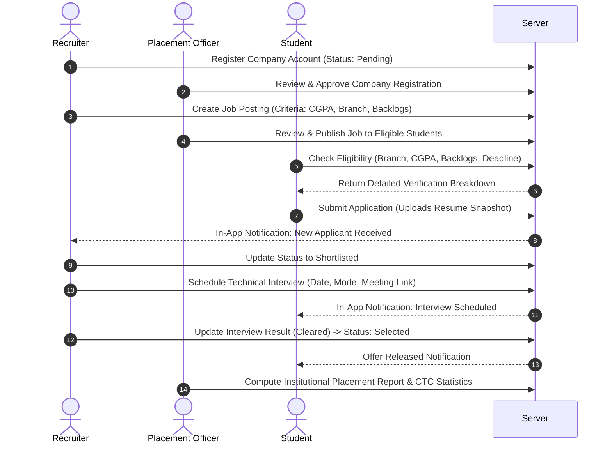

# PlaceConnect — Online Placement & Recruitment Portal

> **Third-Year B.Tech Computer Engineering — Web Technology Project**  
> **Course Demonstration & Comprehensive Viva Documentation**  
> Developed using HTML5, CSS3, Bootstrap 5, Modern Vanilla CSS, JavaScript (ES6+), ReactJS (Vite), NodeJS, ExpressJS, and MongoDB (Mongoose).

---

## 1. Project Abstract

**PlaceConnect** is a full-stack, production-minded campus recruitment portal engineered to connect graduating engineering students, tier-1 corporate recruiters, and the college Training & Placement (T&P) Cell. Traditional campus placement operations suffer from fragmented communication, unreliable spreadsheet tracking, manual resume verifications, and inadvertent duplicate submissions. 

PlaceConnect resolves these challenges through:
1. **Automated Server-Side Eligibility Engine:** Evaluates branch restrictions, graduation year eligibility, minimum CGPA thresholds, maximum active backlog counts, and required core competencies before allowing candidates to apply.
2. **Unified Role-Based Access Control (RBAC):** Distinct workflows and dashboards for **Students**, **Recruiters**, and **Placement Officers (Admins)**.
3. **Structured 5-Stage Recruitment Pipeline:** Transparent status transitions (`Applied` &rarr; `Under Review` &rarr; `Shortlisted` &rarr; `Interview Scheduled` &rarr; `Selected` / `Rejected`).
4. **Data Integrity & Duplicate Prevention:** Compound database indexes on `{ studentId: 1, jobId: 1 }` ensure a candidate can never submit duplicate applications for the same opening.
5. **Real-Time Dashboards & Analytics:** Live placement metrics, branch-wise placement statistics, and application outcome breakdowns computed dynamically from MongoDB records and visualized using **Recharts**.

---

## 2. Problem Statement & Proposed Solution

### The Problem
* **Administrative Bottlenecks:** Placement coordinators manually check whether hundreds of students meet varying criteria (e.g., 7.5 CGPA, 0 backlogs, Computer or IT branch).
* **Information Asymmetry:** Students have little visibility into where their resume is in the pipeline once submitted.
* **Corporate Overhead:** Recruiters struggle to coordinate interview schedules, mode links (Google Meet/Teams), and candidate feedback across multiple departments.
* **Inaccurate Reporting:** Manual data compilation leads to errors when preparing university accreditation and NIRF ranking placement statistics.

### The Proposed Solution
* **PlaceConnect Centralized Platform:** A unified MERN architecture providing automated eligibility checking, verified resume uploads, interview scheduling with calendar notifications, and instant administrative audit reports.

---

## 3. Technology Stack

### Frontend
* **Core Framework:** React 18 with Vite (Fast HMR & Optimized Production Bundler)
* **Language:** JavaScript (ES6+ Modules, Async/Await)
* **Routing:** React Router v6 (Nested layouts, public pages, role-based protected dashboard routes)
* **Styling & Design System:** Bootstrap 5.3 + Custom CSS Tokens (`var(--pc-primary)`, modern typography, glassmorphism touches, responsive mobile drawer)
* **HTTP Client:** Axios (Custom interceptors for Bearer token injection and centralized error handling)
* **Data Visualization:** Recharts (Dynamic BarCharts for branch placements & pipeline outcomes)
* **Icons:** Lucide React

### Backend
* **Runtime:** Node.js (v20+ / v24 compatible)
* **Framework:** Express.js (Modular routing, centralized middleware architecture)
* **Database & ODM:** MongoDB with Mongoose 8.x
* **Security & Auth:** JSON Web Tokens (JWT), bcryptjs password hashing, helmet, cookie-parser, cors
* **Input Validation:** express-validator (Server-side schema validation for registration, job posting, and recruitment transitions)
* **File Uploads:** Multer (Local disk storage with file type filtering `.pdf, .doc, .docx` and size limits)
* **Testing:** Vitest & Supertest with MongoDB Memory Server for 100% zero-config execution

---

## 4. User Roles & Permission Matrix

| Feature / Resource | Student | Recruiter | Placement Admin |
| :--- | :---: | :---: | :---: |
| Self Registration & Profile Management | ✅ | ✅ | Script / Env Seed |
| Resume Upload & Download | ✅ (Own) | ✅ (Applicants) | ✅ (All) |
| Browse Published Job Drives | ✅ | ✅ | ✅ |
| Check Real-Time Job Eligibility | ✅ | &mdash; | &mdash; |
| Submit / Withdraw Application | ✅ | &mdash; | &mdash; |
| Post & Edit Job Openings | &mdash; | ✅ (Own Company) | ✅ (All) |
| Approve / Reject Job Postings | &mdash; | &mdash; | ✅ |
| Review Job Applicants & Resumes | &mdash; | ✅ (Own Jobs) | ✅ |
| Move Application Stages (`Under Review`, etc.) | &mdash; | ✅ | ✅ |
| Schedule Interviews with Meeting Links | &mdash; | ✅ | ✅ |
| View Company Placement Analytics | &mdash; | ✅ | ✅ |
| Approve / Reject Company Registrations | &mdash; | &mdash; | ✅ |
| System Dashboard & Branch Placement Charts | &mdash; | &mdash; | ✅ |
| Broadcast Campus Placement Announcements | &mdash; | &mdash; | ✅ |
| Generate Official Placement Reports & CTC Audits | &mdash; | &mdash; | ✅ |

---

## 5. System Architecture & Workflows

### Architecture Diagram (Mermaid)



### Recruitment Workflow Diagram (Mermaid)



---

## 6. MongoDB Data Models & Schema Design

### 1. `User`
* `name`: String (required, trimmed)
* `email`: String (required, unique, lowercased)
* `passwordHash`: String (bcrypt hashed, `select: false` by default)
* `role`: Enum `['student', 'recruiter', 'admin']` (default: `'student'`)
* `accountStatus`: Enum `['active', 'inactive', 'suspended', 'pending']`
* `lastLoginAt`: Date

### 2. `StudentProfile`
* `userId`: ObjectId ref `User` (unique)
* `PRN`: String (Permanent Registration Number, unique, uppercase)
* `phone`: String
* `branch`: Enum `['Computer Engineering', 'Information Technology', 'Electronics & Telecommunication', 'AIDS', 'Mechanical Engineering', 'Civil Engineering', 'Electrical Engineering', 'Other']`
* `graduationYear`: Number (2024–2035)
* `CGPA`: Number (min: 0, max: 10)
* `backlogs`: Number (min: 0, default: 0)
* `skills`: Array of Strings
* `projects`: Array of `{ title, description, technologies, githubUrl, liveUrl }`
* `resume`: `{ fileName, originalName, filePath, fileSize, mimeType, uploadedAt }`

### 3. `Company`
* `ownerUserId`: ObjectId ref `User` (unique)
* `companyName`: String (required, trimmed)
* `industry`: String (required)
* `description`: String (required)
* `website`: String
* `location`: String
* `contactInformation`: `{ contactPerson, contactEmail, contactPhone }`
* `approvalStatus`: Enum `['pending', 'approved', 'rejected']` (default: `'pending'`)
* `rejectionReason`: String
* `approvedAt`: Date, `approvedBy`: ObjectId ref `User`

### 4. `Job`
* `companyId`: ObjectId ref `Company` (required)
* `createdBy`: ObjectId ref `User` (required)
* `title`: String (required)
* `description`: String (required)
* `responsibilities`: `[String]`
* `requiredSkills`: `[String]`
* `eligibleBranches`: `[String]`
* `minimumCGPA`: Number (default: 6.0)
* `maximumBacklogs`: Number (default: 0)
* `eligibleGraduationYears`: `[Number]`
* `location`: String
* `jobType`: Enum `['Full-Time', 'Internship', 'Internship + PPO', 'Part-Time', 'Contract']`
* `salaryRange`: `{ min, max, currency, period }`
* `applicationDeadline`: Date
* `status`: Enum `['active', 'closed', 'draft']`
* `approvalStatus`: Enum `['pending', 'approved', 'rejected']`

### 5. `Application`
* `studentId`: ObjectId ref `StudentProfile` (required)
* `userId`: ObjectId ref `User` (required)
* `jobId`: ObjectId ref `Job` (required)
* `appliedAt`: Date
* `resumeSnapshot`: `{ fileName, originalName, filePath, fileSize, uploadedAt }`
* `coverLetter`: String
* `status`: Enum `['Applied', 'Under Review', 'Shortlisted', 'Interview Scheduled', 'Selected', 'Rejected', 'Withdrawn']`
* `statusHistory`: `[{ status, changedBy, changedAt, note }]`
* `withdrawnAt`: Date
* **Compound Unique Index:** `{ studentId: 1, jobId: 1 }` (Prevents duplicate applications at DB layer)

### 6. `Interview`
* `applicationId`: ObjectId ref `Application` (required)
* `jobId`: ObjectId ref `Job` (required)
* `studentId`: ObjectId ref `StudentProfile` (required)
* `roundName`: String (e.g. `'Round 1: Coding & DSA'`, `'HR Discussion'`)
* `scheduledAt`: Date
* `mode`: Enum `['Online', 'Offline', 'Hybrid']`
* `locationOrMeetingLink`: String
* `instructions`: String
* `result`: Enum `['Pending', 'Cleared', 'Failed', 'Cancelled', 'Rescheduled']`
* `feedback`: String
* `createdBy`: ObjectId ref `User`

### 7. `Notification`
* `userId`: ObjectId ref `User` (index)
* `title`: String
* `message`: String
* `type`: Enum `['application', 'interview', 'job', 'company', 'announcement', 'general']`
* `readAt`: Date (null if unread)
* `relatedResource`: `{ resourceType, resourceId }`

### 8. `PlacementDrive` (Announcements)
* `title`: String
* `description`: String
* `participatingCompanies`: `[ObjectId ref Company]`
* `participatingJobs`: `[ObjectId ref Job]`
* `eligibilityCriteria`: String
* `startDate`: Date, `endDate`: Date
* `isPublished`: Boolean

---

## 7. REST API Endpoints Reference

Base Prefix: `/api/v1`

### Authentication (`/api/v1/auth`)
* `POST /auth/register/student` &mdash; Register student user + profile
* `POST /auth/register/recruiter` &mdash; Register recruiter user + company profile
* `POST /auth/login` &mdash; Authenticate user, issue JWT token & cookie
* `POST /auth/logout` &mdash; Clear cookie & invalidate session
* `GET /auth/me` &mdash; Fetch current authenticated user with role-specific profile

### Student Profile & Resume (`/api/v1/students`)
* `GET /students/me` &mdash; Get current student profile
* `PATCH /students/me` &mdash; Update CGPA, backlogs, skills, bio, links
* `POST /students/me/resume` &mdash; Upload resume file (Multer)
* `GET /students/:studentId/resume` &mdash; Securely download resume (authorized student, recruiter, or admin only)

### Job Postings & Eligibility (`/api/v1/jobs`)
* `GET /jobs` &mdash; Browse active, approved jobs (search, branch, jobType, salary, pagination)
* `GET /jobs/:id` &mdash; Get single job specifications with company info
* `GET /jobs/:id/eligibility` &mdash; Run Server Eligibility Engine for logged-in student
* `POST /jobs` &mdash; Recruiter creates new job posting
* `PATCH /jobs/:id` &mdash; Update job posting
* `DELETE /jobs/:id` &mdash; Delete job posting
* `PATCH /jobs/:id/publish` &mdash; Toggle active / closed status

### Applications (`/api/v1/applications`)
* `POST /applications` &mdash; Submit application (evaluates eligibility, enforces unique constraint)
* `GET /applications/my` &mdash; Get logged-in student's applications with status timelines
* `GET /applications/:id` &mdash; Get single application details & history
* `PATCH /applications/:id/withdraw` &mdash; Student withdraws application (only if Applied or Under Review)
* `GET /jobs/:jobId/applications` &mdash; Recruiter reviews applicants for their job
* `PATCH /applications/:id/status` &mdash; Recruiter updates recruitment stage & note

### Interviews (`/api/v1/interviews`)
* `POST /interviews` &mdash; Schedule interview round
* `GET /interviews/my` &mdash; Student views their interview schedule
* `GET /interviews/recruiter` &mdash; Recruiter views all interviews
* `PATCH /interviews/:id` &mdash; Update round details, outcome result, and feedback
* `DELETE /interviews/:id` &mdash; Cancel interview round

### Companies & Recruiter Oversight (`/api/v1/companies`, `/api/v1/recruiter`)
* `GET /companies/me` &mdash; Recruiter gets own company profile
* `PATCH /companies/me` &mdash; Update company profile
* `GET /recruiter/jobs` &mdash; Get recruiter's jobs with applicant counters
* `GET /recruiter/dashboard` &mdash; Recruiter summary metrics and applicant funnel

### Placement Officer Admin (`/api/v1/admin`)
* `GET /admin/dashboard` &mdash; Summary metrics, Recharts branch placements, outcome charts, pending queues
* `GET /admin/students` &mdash; Paginated student directory with PRN search & branch filters
* `PATCH /admin/students/:userId/status` &mdash; Toggle account status (active / suspended)
* `GET /admin/companies` &mdash; Company directory with status filter
* `PATCH /admin/companies/:id/approval` &mdash; Approve or reject company
* `GET /admin/jobs` &mdash; All jobs across companies
* `PATCH /admin/jobs/:id/approval` &mdash; Approve or reject job posting
* `GET /admin/reports/placements` &mdash; Official placement registry & CTC analytics

### Notifications & Drives (`/api/v1/notifications`, `/api/v1/drives`)
* `GET /notifications` &mdash; Get notifications with unread counter
* `PATCH /notifications/:id/read` &mdash; Mark notification as read
* `PATCH /notifications/read-all` &mdash; Mark all notifications as read
* `GET /drives` &mdash; Get published placement drives and announcements
* `POST /drives` &mdash; Admin creates drive and broadcasts to all students
* `DELETE /drives/:id` &mdash; Delete drive announcement
* `GET /health` &mdash; System health check endpoint

---

## 8. Installation & Windows Execution Guide

### Prerequisites
* **Node.js:** v18.x, v20.x, or v24.x (Checked with Node v24.11.0)
* **npm:** v9.x or higher (Checked with npm v11.19.1)
* **Git:** Installed on Windows
* **MongoDB:** Either a local MongoDB instance, MongoDB Atlas URI, or **Zero-Config In-Memory Mode** (Automatically activated if local mongod is not running!)

### Clone / Navigate to Workspace
```bash
cd "d:\Engineering\Third Year\5th Semester\WT9\Project"
```

### Install Dependencies
Run from workspace root:
```bash
# Install backend dependencies
cd server
npm install

# Install frontend dependencies
cd ../client
npm install
cd ..
```

---

## 9. Environment Variables Configuration

### Server Environment (`server/.env`)
Create `server/.env` (a ready template is provided in `server/.env.example`):
```env
PORT=5000
NODE_ENV=development
CLIENT_URL=http://localhost:5173
MONGODB_URI=mongodb://127.0.0.1:27017/placeconnect
USE_IN_MEMORY_DB=auto
JWT_SECRET=supersecret_jwt_placeconnect_academic_key_2026_dev
JWT_EXPIRES_IN=7d
COOKIE_SECURE=false
UPLOAD_DIR=uploads/resumes
MAX_FILE_SIZE_MB=5
ADMIN_NAME=Placement Director
ADMIN_EMAIL=admin@placeconnect.edu
ADMIN_PASSWORD=Admin@123456
```

> **Note on `USE_IN_MEMORY_DB=auto`:** If local MongoDB is not listening on port 27017, PlaceConnect automatically spins up an embedded MongoDB Memory Server for seamless evaluation without extra software setup!

### Client Environment (`client/.env`)
Create `client/.env` (a template is in `client/.env.example`):
```env
VITE_API_BASE_URL=http://localhost:5000/api/v1
```

---

## 10. Seed Demo Data & Initial Admin Setup

The project includes an intelligent, internally consistent demo dataset:

```bash
cd server
npm run seed
```

### Ready-To-Use Demo Credentials

| Role | Name / Organization | Email | Password | Status / Context |
| :--- | :--- | :--- | :--- | :--- |
| **Admin** | Placement Director (Prof. Rajesh Sharma) | `admin@placeconnect.edu` | `Admin@123456` | Active (Full administrative rights) |
| **Recruiter** | Microsoft Corporation India | `recruiter.msft@microsoft.com` | `Password@123` | Approved (SDE 1 Posting active) |
| **Recruiter** | Google India Pvt Ltd | `campus@google.com` | `Password@123` | Approved (Associate SDE Posting active) |
| **Recruiter** | Infosys Limited | `talent@infosys.com` | `Password@123` | Approved (Specialist Programmer active) |
| **Student** | Aarav Sharma (Computer Engg) | `aarav.sharma@student.edu` | `Password@123` | Placed @ Microsoft (44 LPA) |
| **Student** | Diya Patel (Information Tech) | `diya.patel@student.edu` | `Password@123` | Interview Scheduled @ Google |
| **Student** | Kabir Verma (AIDS) | `kabir.verma@student.edu` | `Password@123` | Shortlisted @ Infosys |
| **Student** | Neha Deshmukh (ENTC) | `neha.deshmukh@student.edu` | `Password@123` | Under Review @ Infosys |

> **Evaluation Shortcut:** The login page features 1-click **"Quick-Fill Demo Credentials"** buttons for Admin, Student, and Recruiter to facilitate instant demonstration during college vivas!

---

## 11. Running the Application

### 1. Start Backend Server
```bash
cd server
npm run dev
```
*Server runs on:* `http://localhost:5000`  
*Health Check:* `http://localhost:5000/api/v1/health`

### 2. Start Frontend Client
In a second terminal:
```bash
cd client
npm run dev
```
*Frontend runs on:* `http://localhost:5173`

---

## 12. Automated Testing & Build Validation

### Run Backend Unit & Integration Tests
```bash
cd server
npm test
```
*Actual observed results:*
```
 RUN  v2.1.9 D:/Engineering/Third Year/5th Semester/WT9/Project/server
 ✓ tests/eligibility.test.js (5 tests)
 ✓ tests/auth.test.js (5 tests)

 Test Files  2 passed (2)
      Tests  10 passed (10)
```

### Validate Production Frontend Build
```bash
cd client
npm run build
```
*Actual observed results:*
```
✓ 2467 modules transformed.
✓ built in 11.94s
dist/index.html                   0.97 kB
dist/assets/index.css             236.64 kB
dist/assets/index.js              887.27 kB
```

---

## 13. Postman Collection & API Testing

A complete Postman test suite is provided in the repository under `/postman`:
1. `postman/PlaceConnect.postman_collection.json`
2. `postman/PlaceConnect.local.postman_environment.json`

### How to Import & Use in Postman:
1. Open Postman &rarr; Click **Import** &rarr; Select both `.json` files.
2. Select the **PlaceConnect - Local Environment** from the environment dropdown.
3. Run the **Health Check** request to ensure the server is responding.
4. Execute **Login Admin**, **Login Student**, or **Login Recruiter** &mdash; the embedded test scripts automatically save the `authToken`, `adminToken`, and `studentToken` variables into the environment for subsequent requests.

---

## 14. Screenshots Section

*(All screens are functional in the live running instance at `http://localhost:5173`)*

* **Home & Landing Page:** `[Screenshot Placeholder: Public Portal Hero, Placement Stats & Workflow]`
* **Browse Jobs & Filters:** `[Screenshot Placeholder: Search by Branch, Job Type, and Compensation]`
* **Job Details & Eligibility Engine:** `[Screenshot Placeholder: Real-time Eligibility Breakdown & Application Modal]`
* **Student Dashboard & Stepper:** `[Screenshot Placeholder: Application Timeline, Stepper, and Interview Alerts]`
* **Recruiter Dashboard & Funnel:** `[Screenshot Placeholder: Active Jobs, Shortlisting, and Candidate Review]`
* **Admin Dashboard & Recharts:** `[Screenshot Placeholder: Branch Placements Bar Chart & Outcome Funnel]`
* **Placement Reports Table:** `[Screenshot Placeholder: CTC Registry with Highest, Average, and Lowest Packages]`

---

## 15. Syllabus Practicals Mapping (WT Curriculum)

This project maps directly to standard Third-Year B.Tech Computer Engineering Web Technology practical outcomes:

| Syllabus Practical / Competency | Implementation in PlaceConnect |
| :--- | :--- |
| **HTML5 Semantic Structure & Forms** | Semantic `<header>`, `<nav>`, `<main>`, `<aside>`, `<footer>`, `<form>`, date pickers, number bounds |
| **CSS3 Responsive Layouts & Design Tokens** | Bootstrap 5 grid, custom CSS variables, status badges, timeline stepper, mobile drawer navigation |
| **Client-Side Validation & Events** | React controlled inputs, CGPA range check (0-10), phone regex, deadline dates, file format filtering |
| **RESTful API Development** | Express.js routers implementing `/api/v1/auth`, `/jobs`, `/applications`, `/interviews`, `/admin` |
| **CRUD Operations with MongoDB** | Mongoose schemas with Create, Read, Update, Delete for Jobs, Profiles, Applications, and Drives |
| **Session & Token Authentication** | JWT signing/verification, bcrypt password hashing, HTTP-only cookie support |
| **API Testing using Postman** | JSON Postman collection & environment with automated bearer token assignment |
| **Server-Side Validation & Error Handling** | express-validator schema rules, centralized error middleware, duplicate key handling |

---

## 16. Suggested Viva Questions & Answers

1. **Q: How does PlaceConnect prevent duplicate job applications?**  
   *A:* At the database layer, Mongoose applies a compound unique index on `{ studentId: 1, jobId: 1 }` in the `Application` collection. At the application layer, the server-side `checkEligibility()` engine checks for an existing record before submission and throws a 409 Conflict error.

2. **Q: Why is eligibility checked on the server rather than only on the frontend?**  
   *A:* Client-side checks can be bypassed using Postman or browser developer tools. Centralizing criteria evaluation in the server's `checkEligibility()` function guarantees that business rules (minimum CGPA, non-negative backlogs, branch match) are enforced reliably before writing to MongoDB.

3. **Q: How are passwords secured in the database?**  
   *A:* Passwords are never stored in plaintext. They are salted with 10 salt rounds and hashed using `bcryptjs`. The Mongoose User schema sets `passwordHash` to `select: false` so that credentials are never inadvertently returned in API responses.

4. **Q: What is the purpose of MongoDB Memory Server in this project?**  
   *A:* For academic demonstrations on Windows machines without an active MongoDB Windows Service, `db.js` automatically starts an embedded in-memory MongoDB instance when `USE_IN_MEMORY_DB=auto`, allowing the application and seed scripts to run with zero installation overhead.

5. **Q: How are recruitment status transitions controlled?**  
   *A:* Allowed status transitions (`Applied` &rarr; `Under Review` &rarr; `Shortlisted` &rarr; `Interview Scheduled` &rarr; `Selected` / `Rejected`) are enforced on the backend. Only authenticated recruiters who own the job or placement admins can invoke `PATCH /applications/:id/status`.

---

## 17. Security Considerations & Limitations

* **File Storage:** In development, resumes are stored on local disk under `server/uploads/resumes`. In enterprise production, this should be redirected to an S3-compatible cloud object store (AWS S3 or Google Cloud Storage).
* **HTTPS & Cookies:** For production deployment, set `NODE_ENV=production` and `COOKIE_SECURE=true` to enforce encrypted HTTPS transmission.
* **Email Gateway:** While in-app notifications are implemented fully in MongoDB, an external SMTP relay (e.g. Nodemailer with Amazon SES/SendGrid) can be enabled by configuring SMTP credentials in `server/.env`.
